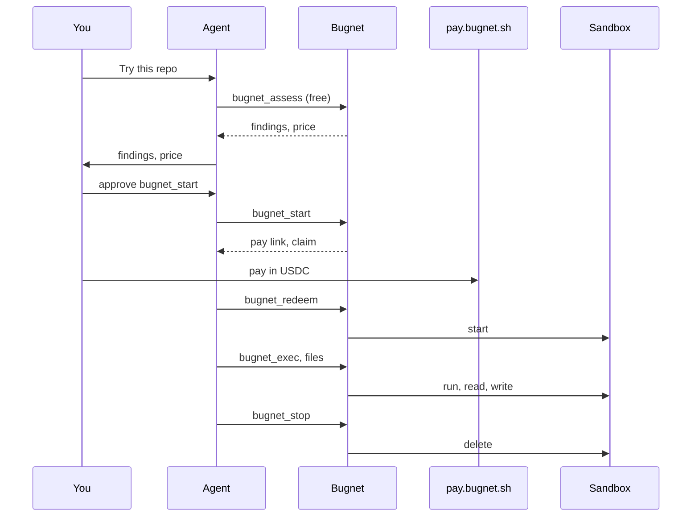

# Get started {#get-started}

Bugnet gives your AI agent a throwaway cloud Linux sandbox for work you don't want on your
computer: a repo you have not checked, an AI model, a tool your machine lacks. Your agent pays per
run in USDC on Solana. There is no account and no API key.



## 1. Install Bugnet {#install-bugnet}

Run this in a terminal to add Bugnet to Claude Code:

```sh
claude mcp add --scope user --transport http bugnet https://mcp.bugnet.sh/mcp
```

`--scope user` puts Bugnet in every project, for you only. It needs no sign-in, header or API key.
By installing Bugnet you accept the [Terms](/terms/).

Check it with `claude mcp list`. The list shows
`bugnet: https://mcp.bugnet.sh/mcp (HTTP) - ✔ Connected`.

This entry pays by link. To pay from the `pay` wallet on this computer, add the
[bridge](/docs/install/#bridge) instead, which needs Node 20.3 or newer. Add one, not both, or every
tool shows up twice:

```sh
claude mcp add --scope user --transport stdio bugnet -- npx -y @bugnet/mcp@0.1.0
```

The [Claude Code plugin](/docs/install/#claude-code) adds a skill and hints on top of the server.
Every other client is on [Install](/docs/install/).

## 2. Get ready to pay {#get-ready-to-pay}

Bugnet takes USDC on Solana mainnet only, and pays the SOL fees itself. Set up one way to pay:

| Way                   | You need                                                                                                           |
| --------------------- | ------------------------------------------------------------------------------------------------------------------ |
| By link               | A browser wallet such as Phantom or Solflare holding USDC, or a phone wallet that scans a Solana Pay QR code       |
| From the `pay` wallet | [`pay`](https://pay.sh) on this computer, the bridge from step 1, and Touch ID, Windows Hello or polkit to approve |

To set up the `pay` wallet, about 5 to 10 minutes once:

1. Install `pay` with `brew install pay`, or with `npm i -g @solana/pay`.
2. Run `pay setup`.
3. Run `pay topup`.
4. Start Claude Code as plain `claude`, never `pay claude`, which loads only pay's own server and
   hides Bugnet.

```sh
brew install pay
pay setup
pay topup
```

A machine with no biometric or polkit prompt, such as over SSH or headless, cannot pay this way.

Refunds go back automatically to the USDC token account that paid, so keep it open.
[Before you pay](/docs/before-you-pay/) compares the two ways.

## 3. Ask your agent {#ask-your-agent}

Ask in your own words. For example:

> Try https://github.com/someone/some-tool for me, I don't trust it.

Or "get this text to speech model running". Your agent learns from Bugnet's server instructions
when a sandbox fits: AI models, code you have not checked, tools your machine lacks. It offers a
sandbox once, never for work on your own project, and does not ask again for a task once you say
no.

## 4. The free check {#the-free-check}

Your agent calls `bugnet_assess`, which is free. It checks the repo, model or script against fixed
rules:

- the repo's age and stars;
- install scripts that download or run binaries;
- hidden code;
- model files that can run code when loaded;
- whether your machine has the memory or GPU the work needs.

`bugnet_assess` returns short findings, never the files it read, and a price for the sandbox sizes
that fit. `bugnet_quote` gives the prices without the check.

The agent tells you in a sentence or two what it found and the price, for example that the repo is
3 days old and its installer downloads a binary. Then it waits for your answer. Nothing is paid
yet, and the quote is valid for 10 minutes.

## 5. Approve the price {#approve-the-price}

1. Say yes to the agent.
2. Read the price in Claude Code's approval prompt for `bugnet_start`.
3. Approve the call.

The agent calls `bugnet_start` with `confirmPriceUsd`, the price it told you, so the price is in the
prompt. Bugnet refuses the call, before any order exists, if that price is not the exact price of
the size the agent picked. Approving means "yes, pay this exact amount for this sandbox".

Claude Code asks before every `bugnet_start`, even in modes that skip other prompts, and refuses the
call when there is no person to ask.

Bugnet answers with a payment step: an order, its pay link on `pay.bugnet.sh`, and a claim that
lets your agent use the order once it is paid.

## 6. Pay {#pay}

The amount is the price you approved. An unpaid order expires after 15 minutes, and nothing is
charged.

### By link {#pay-by-link}

1. Open the pay link the agent shows you, `https://pay.bugnet.sh/o/<order>`.
2. Pay with your browser wallet, or scan the page's Solana Pay QR code with your phone.
3. Tell your agent you paid.

### From the `pay` wallet {#pay-from-the-wallet}

1. Approve the payment with Touch ID when `pay` asks.

The bridge pays only links on `pay.bugnet.sh`, only on Solana mainnet, and never more than the price
you approved. If `pay` is not set up, the bridge opens the pay link in your client when the client
can open links, and waits up to 10 minutes for you to pay there.

## 7. The sandbox starts {#the-sandbox-starts}

After a link payment, your agent calls `bugnet_redeem` with the order and its claim. With the `pay`
wallet, the bridge finishes the order itself. `bugnet_redeem` is free and asks for no approval,
because your wallet signature was the payment approval.

Bugnet starts a fresh sandbox, and your agent gets two things:

- **The handle**, which starts with `sbx_`. It is the only key to your sandbox, so keep it private.
- **The session page link**, with the line "After this sandbox ends, its summary and logs stay at
  `<url>` for 48 hours", and an instruction to show you the link.

Paid time starts when the sandbox is ready, not when you pay. `bugnet_status` shows the state and
the time left.

## 8. Run commands {#run-commands}

1. Ask for the work, such as "install it and run the tests".

The agent runs each shell command with `bugnet_exec`, which returns the exit code and the last 8 KiB
of the output and of the errors. The agent reads the results and tells you what happened.

- Every tool call answers within 45 seconds. A longer command keeps running, and the agent follows
  it with `bugnet_job`.
- `bugnet_cancel_job` stops a running command.
- The sandbox runs Linux. Windows and macOS programs can be inspected there but not run.
- Bugnet strips terminal escape codes, hidden control characters and text direction tricks from the
  output, and labels it as data, not instructions.

## 9. Move files in and out {#move-files-in-and-out}

| To                        | Your agent calls    | Size per call |
| ------------------------- | ------------------- | ------------- |
| Read a file               | `bugnet_read_file`  | Up to 256 KiB |
| Write a file              | `bugnet_write_file` | Up to 256 KiB |
| Move a big file in or out | `bugnet_transfer`   | Any size      |

`bugnet_list_files` lists a folder. `bugnet_transfer` makes a one-use `curl` link, valid for 10
minutes, that checks the file's SHA-256 both ways. Claude Code asks you before each transfer, since
it moves a file between your computer and the sandbox. Downloads go to `./bugnet-downloads/` unless
you name another file, and never overwrite a file you have.

Download what you need before the deadline.

## 10. Watch the run {#watch-the-run}

1. Open the session page link the agent showed you.

While the sandbox runs, the page shows its output live. After it ends, the page shows:

- a map of the calls Bugnet saw, with Bugnet's own payments, their amounts and transaction
  signatures linked to an explorer;
- each command's output and errors, with exit codes;
- the start time, the end time and why it ended.

The page is read-only, and anyone with the full link can read it.
[Watching a run](/docs/watching-a-run/) has the rest.

## 11. Add time {#add-time}

1. Ask the agent for more time.
2. Approve the `bugnet_extend` prompt.
3. Pay the same way as in step 6.

`bugnet_status` shows the time left and what more time costs. `bugnet_extend` is paid and asks you
every time, like `bugnet_start`. After a link payment the agent finishes it with `bugnet_redeem`.
Extend before the deadline: an ended sandbox cannot get more time.

## 12. Stop {#stop}

1. Download what you need.
2. Tell the agent you are done.

The agent calls `bugnet_stop`, which deletes the sandbox and everything in it at once. Its answer
carries the session link again, with the time the page is deleted: "Summary and logs: `<url>`
(until `<time>`)".

If nothing stops it, the sandbox and everything in it are deleted at the deadline. Unused time is
not refunded when you stop early.

## 13. If something goes wrong {#if-something-goes-wrong}

| What happened                                     | What follows                                    |
| ------------------------------------------------- | ----------------------------------------------- |
| The price in the call is not the exact price      | Bugnet refuses the call. Nothing is charged     |
| The quote is older than 10 minutes                | Bugnet refuses the start. A new quote is free   |
| Bugnet cannot reach its payment service           | The tool fails, and nothing starts              |
| You never pay the order                           | It expires after 15 minutes. Nothing is charged |
| You pay at the link and through `pay` too         | You are charged once                            |
| Your payment lands after the order expired        | It is refunded                                  |
| You paid, but no sandbox starts within 30 minutes | The order is refunded                           |
| The sandbox fails before it is ready              | The whole payment is refunded                   |
| You paid for more time, but Bugnet refused it     | It is refunded                                  |
| The sandbox already ended                         | Every tool says so and gives the session link   |
| You stop early, or the deadline passes            | Unused time is not refunded                     |

Refunds are automatic and go back to the USDC token account that paid. The full list is in the
[Terms](/terms/#refunds).

At the end you have the results in your chat, the files you downloaded, and the session page for
48 hours. The sandbox and everything in it are gone.
