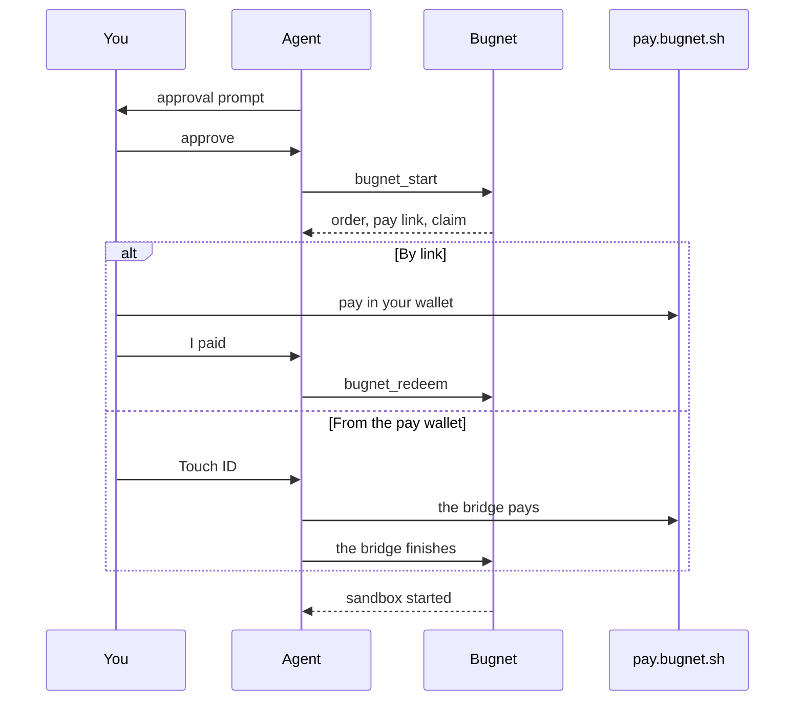

# Paying

Bugnet uses [x402](https://www.x402.org), an open standard for paying over HTTP. There is no
account to create and no API key to keep. You pay per run in USDC on Solana mainnet, and Bugnet
pays the SOL fees.

## Steps {#steps}

1. Your agent tells you the size and the price, from the free `bugnet_assess` or `bugnet_quote`.
2. It calls `bugnet_start` with that price as `confirmPriceUsd`, and you approve the call.
3. Bugnet answers with a payment step: an order, its pay link on `pay.bugnet.sh`, and a claim that
   lets your agent use the order once it is paid.
4. You pay the order, by link or from the `pay` wallet.
5. Your agent calls the free `bugnet_redeem` with the order and its claim, and Bugnet starts the
   sandbox.

`bugnet_redeem` asks for no approval, because your wallet signature was the payment approval.
More time with `bugnet_extend` is paid the same way, and `bugnet_redeem` then also takes the
sandbox's handle.

## The approval click {#the-approval-click}

`bugnet_start` and `bugnet_extend` are marked as tools a person must approve. Claude Code asks you
before every call, even in modes that skip other prompts, and refuses the call when there is no
person to ask.

The call carries `confirmPriceUsd`, the price your agent told you, so you see it in the prompt.
Bugnet refuses the call, before any order exists, if that price is not the exact price of the size
your agent picked. So approving means "yes, pay this exact amount for this sandbox".

Other clients ask according to their own tool approval settings, so keep approval on for these two
tools.

## Paying by link {#paying-by-link}

1. Open the pay link your agent shows you, `https://pay.bugnet.sh/o/<order>`.
2. Pay with a browser wallet such as Phantom or Solflare, or scan the page's Solana Pay QR code
   with your phone.
3. Tell your agent you paid.

Your agent then calls `bugnet_redeem`. This works in every client, claude.ai included.

## Paying from the `pay` wallet {#paying-from-the-pay-wallet}

1. Approve the `bugnet_start` prompt.
2. Approve the payment with Touch ID when `pay` asks.

With the `bugnet-wallet` plugin, the [bridge](/docs/install/#bridge) or Claude Desktop, the bridge
pays the order with [`pay`](https://pay.sh) on your computer, then finishes the order. It pays only
links on `pay.bugnet.sh`, only on Solana mainnet, and never more than the price you approved.

Without `pay`, the bridge opens the pay link in your client when the client can open links, and
waits up to 10 minutes for you to pay.

## The claim {#the-claim}

The claim is the order's secret. Bugnet returns it once, with the payment step, and never again.
Whoever holds the order and its claim can redeem the paid order, so your agent keeps the claim to
itself until it calls `bugnet_redeem`.

## Never charged twice {#never-charged-twice}

- Bugnet never asks again for an order that is already paid.
- If you pay at the link and the bridge pays too, the second payment is never sent to Solana.
- While a payment is still confirming, Bugnet says so instead of asking for another.
- A retry of the same call with the same order and claim returns the same result.

## Prices {#prices}

A sandbox comes in fixed sizes: CPU, memory, disk and minutes. Each has a fixed price in USDC.

- `bugnet_assess` and `bugnet_quote` show the prices for free, before anything is paid. A quote is
  valid for 10 minutes.
- `bugnet_status` shows what more time costs.
- You pay exactly the price you approved: Bugnet charges that amount or refuses.
- Paid time starts when the sandbox is ready, not when you pay.
- Stopping early does not refund the unused time.

A small sandbox for ten minutes costs a few cents. The current sizes and prices are on the
[stats page](/stats/#limits).

## Order times {#order-times}

| Order                                      | What happens                       |
| ------------------------------------------ | ---------------------------------- |
| Unpaid after 15 minutes                    | It expires, and nothing is charged |
| Paid, but no sandbox started in 30 minutes | It is refunded                     |
| Paid after it expired                      | It is refunded                     |

## Refunds {#refunds}

Refunds are automatic. They go back in USDC to the token account that paid, never more than you
paid, so keep that account open until any refund arrives.

| What happened                                  | Refund                         |
| ---------------------------------------------- | ------------------------------ |
| The sandbox failed before it was ready         | Full                           |
| You paid for more time, but Bugnet refused it  | Full                           |
| A paid order was never used to start a sandbox | Full, 30 minutes after payment |
| You paid after the order expired               | Full                           |
| You ran `bugnet_stop`, or the deadline passed  | None                           |

The full table is in the [Terms](/terms/#refunds).

## Where you pay {#where-you-pay}

`pay.bugnet.sh` is the only place you ever pay. Any other page that asks for a Bugnet payment is
not Bugnet's. Bugnet's hosts:

| Host                 | What it is           |
| -------------------- | -------------------- |
| `bugnet.sh`          | The website and docs |
| `mcp.bugnet.sh`      | The MCP server       |
| `pay.bugnet.sh`      | Checkout             |
| `sessions.bugnet.sh` | Session pages        |
