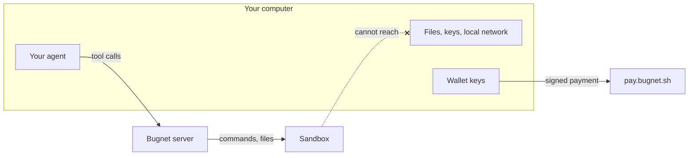

# Safety

Code in the sandbox runs on a cloud machine, not yours. It cannot reach your files, your keys or
your local network, and Bugnet sees only the tool calls your agent sends.

## No AI on Bugnet's side {#no-ai-on-bugnets-side}

Bugnet's server is plain code. It calls no AI model and does not read your conversation. It sees
only the tool calls your agent sends. Your own agent decides when to suggest Bugnet.

The risk check in `bugnet_assess` is a set of fixed rules: repo age and stars, install scripts that
download or run binaries, hidden code, model files that can run code when loaded, and whether your
machine has the memory or GPU the work needs. It returns short findings, never the files it read.

## The sandbox {#the-sandbox}

- Code in the sandbox runs on a cloud machine, not yours. It cannot reach your files, your keys or
  your local network.
- Everything is deleted at the deadline. Download what you need before then.
- The sandbox handle, which starts with `sbx_`, is the only key to your sandbox. Keep it private.
  Bugnet's logs name a sandbox only by a short hash of it.

Sandboxes run on cloud machines that Bugnet rents from hosting companies, and those companies run
the hardware your sandbox is on.

## Sandbox output {#sandbox-output}

Bugnet treats everything the sandbox sends back as untrusted:

1. It strips terminal escape codes, hidden control characters and text direction tricks.
2. It keeps the last 8 KiB of each stream.
3. It labels the output as data, not instructions.

## Payments {#payments}

- `bugnet_start` and `bugnet_extend` ask you before every call, and carry the price you were told.
  Bugnet refuses a call whose price is not the exact price of the size.
- `pay.bugnet.sh` is the only place you ever pay.
- The bridge pays only links on `pay.bugnet.sh`, only on Solana mainnet, and never more than the
  price you approved.

## The server {#the-server}

Bugnet's server refuses calls from web pages on other sites, apart from hosted clients such as
claude.ai, and no page can show it in a frame.

## What Bugnet can and cannot see {#what-bugnet-can-and-cannot-see}

Bugnet can see:

- the tool calls your agent sends, such as commands, file contents and repo or model names;
- what the sandbox sends back, such as output and files;
- your IP address, which limits how often `bugnet_assess` and `bugnet_quote` are called;
- the wallet that paid, which is public on Solana anyway;
- file transfer traffic, which passes through Bugnet's servers.

Bugnet cannot see:

- your conversation with your agent;
- anything on your computer that your agent does not send;
- your wallet keys, which stay in your wallet;
- the sandbox's other internet traffic.

## Security problems {#security-problems}

Report them privately, as
[SECURITY.md](https://github.com/bugnet-sh/bugnet/blob/main/SECURITY.md) says.
