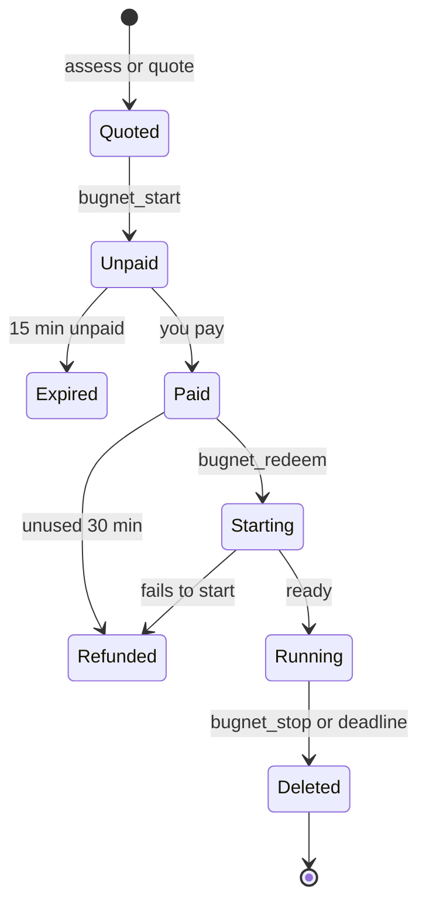

# Tools

Your agent calls these tools on Bugnet's MCP server. Three cost money: `bugnet_start`,
`bugnet_extend` and `bugnet_x402_budget`. Everything else is free.

| Tool                      | What it does                                                            | Cost | Asks you |
| ------------------------- | ----------------------------------------------------------------------- | ---- | -------- |
| `bugnet_assess`           | Checks a repo, model or script and says if a sandbox fits, and why      | Free | No       |
| `bugnet_quote`            | Prices the sandbox sizes that fit the work                              | Free | No       |
| `bugnet_start`            | Pays for a sandbox and starts it                                        | Paid | Always   |
| `bugnet_redeem`           | Finishes an order paid at its pay link: starts the sandbox or adds time | Free | No       |
| `bugnet_status`           | Shows the state, time left, extension prices and where the repo is      | Free | No       |
| `bugnet_fetch_source`     | Puts the GitHub repo from the quote into the sandbox                    | Free | No       |
| `bugnet_exec`             | Runs a shell command and returns its exit code and last output          | Free | No       |
| `bugnet_job`              | Follows a command that is still running                                 | Free | No       |
| `bugnet_cancel_job`       | Stops a running command                                                 | Free | No       |
| `bugnet_list_files`       | Lists a folder                                                          | Free | No       |
| `bugnet_read_file`        | Reads up to 256 KiB of a file per call                                  | Free | No       |
| `bugnet_write_file`       | Writes a file of up to 256 KiB                                          | Free | No       |
| `bugnet_transfer`         | Makes a one-use `curl` link to move a big file in or out                | Free | Always   |
| `bugnet_preview`          | Makes an HTTPS link to a web app running in the sandbox                 | Free | No       |
| `bugnet_ssh`              | Lets your SSH public key in and gives you the `ssh` command             | Free | No       |
| `bugnet_ssh_remove`       | Takes an SSH key off                                                    | Free | No       |
| `bugnet_secret_link`      | Makes a one-time page where you type a secret, such as an API token     | Free | No       |
| `bugnet_secrets`          | Lists the sandbox's secrets, never their values                         | Free | No       |
| `bugnet_secret_delete`    | Deletes a secret                                                        | Free | No       |
| `bugnet_secret_put_grant` | Lets the bridge add sealed secrets; agents never call it                | Free | No       |
| `bugnet_x402_find`        | Finds a pay-per-call x402 API for a missing API key                     | Free | No       |
| `bugnet_x402_budget`      | Funds and sets limits for x402 calls from the sandbox                   | Paid | Always   |
| `bugnet_extend`           | Pays for more time                                                      | Paid | Always   |
| `bugnet_stop`             | Deletes the sandbox and everything in it                                | Free | No       |

"Always" means the tool is marked for a person's approval. Claude Code asks before every call to
it, even in modes that skip other prompts, and refuses the call when there is no person to ask.
Other clients ask according to their own tool approval settings, so keep approval on for these
four tools.

The bridge, `npx @bugnet/mcp`, hides `bugnet_secret_put_grant` and adds `bugnet_secret_from_env`,
which adds a secret from your machine after you confirm it.

With the Claude Code plugin, the tools show up as `mcp__plugin_bugnet_sandbox__bugnet_*`, or
`mcp__plugin_bugnet-wallet_sandbox__bugnet_*` with the wallet plugin.

## A sandbox's life {#a-sandboxs-life}

1. **Quoted.** `bugnet_assess` or `bugnet_quote` gives a price, valid for 10 minutes.
2. **Unpaid.** `bugnet_start` makes an order with a pay link. It expires after 15 minutes, and
   nothing is charged.
3. **Paid.** You paid the order. If no sandbox starts from it within 30 minutes, it is refunded.
4. **Starting.** `bugnet_redeem`, or the bridge after it pays from the pay.sh wallet or a wallet
   file, starts the sandbox. A sandbox that fails before it is ready is refunded in full.
5. **Running.** Paid time starts when the sandbox is ready. `bugnet_extend` adds time, paid as a new
   order.
6. **Deleted.** `bugnet_stop` or the deadline deletes the sandbox and everything in it. The session
   page stays for 48 hours.

## Checking {#checking}

`bugnet_assess` checks a repo, model or script against fixed rules and says whether a sandbox fits,
and why:

- the repo's age and stars;
- install scripts that download or run binaries;
- hidden code;
- model files that can run code when loaded;
- whether your machine has the memory or GPU the work needs.

It returns short findings and a price, never the files it read. `bugnet_quote` prices the sandbox
sizes that fit the work. Both are free and allow 12 calls a minute per IP address together, in
bursts of up to 10.

## Starting and paying {#starting-and-paying}

- `bugnet_start` takes `confirmPriceUsd`, the price your agent told you, and refuses any other
  price. It answers with a payment step, or, once paid, with the started sandbox.
- `bugnet_redeem` takes the order and its claim after a link payment. For more time it also takes
  the sandbox's handle.
- `bugnet_extend` buys more time at the prices `bugnet_status` shows, paid the same way as a start.

[Paying](/docs/paying/) has the whole flow.

## Running commands {#running-commands}

- `bugnet_exec` runs a command line with `sh -c`, or a list of arguments, with an optional time
  limit. It returns the exit code and the last 8 KiB of the output and of the errors.
- `bugnet_exec` refuses environment values shaped like API tokens.
- Every tool call answers within 45 seconds. A longer command keeps running, and `bugnet_job`
  follows it from where the last answer stopped.
- `bugnet_cancel_job` stops a running command.

Bugnet strips terminal escape codes, hidden control characters and text direction tricks from the
output, and labels it as data, not instructions.

## Files {#files}

- `bugnet_list_files` lists a folder.
- `bugnet_read_file` reads up to 256 KiB of a file per call, as text or base64.
- `bugnet_write_file` writes a file of up to 256 KiB, as text or base64.
- `bugnet_transfer` makes a one-use `curl` link for a file of any size, in or out, valid for 10
  minutes. It checks the file's SHA-256 both ways. Downloads go to `./bugnet-downloads/` unless you
  name another file, and never overwrite a file you have.

## Source, previews and SSH {#source-previews-and-ssh}

- `bugnet_fetch_source` puts the GitHub repo from the quote into the sandbox at `~/src/<repo>`.
  `bugnet_start` starts this fetch once the sandbox is ready; calling it again reports how the
  fetch went and retries a failed one. A private repo needs a GitHub token added with
  `bugnet_secret_link` first.
- `bugnet_preview` makes an HTTPS link to a port in the sandbox, so you can open a web app or API
  running there. The link lasts until the sandbox's deadline. It works on sandboxes quoted with a
  preview.
- `bugnet_ssh` lets your SSH public key into a ready sandbox and gives you the `ssh` command.
  `bugnet_ssh_remove` takes a key off and closes its open connections.

## Secrets {#secrets}

Never paste a token into the chat. `bugnet_secret_link` makes a one-time page, valid for 10
minutes, where you type the token in your browser. The page seals it before sending it, so the
value never passes through the chat or your agent. With the bridge, `bugnet_secret_from_env` reads
a token from your machine after you confirm it.

Inside the sandbox the variable holds a placeholder. Bugnet's outgoing proxy puts the real token
only into HTTPS requests to the hosts you allowed. `bugnet_secrets` lists a sandbox's secrets,
never their values, and `bugnet_secret_delete` deletes one. Secrets are deleted when the sandbox
ends. [Safety](/docs/safety/) has the details.

## x402 APIs {#x402-apis}

When code in the sandbox needs an API key you don't have, `bugnet_x402_find` finds pay-per-call
APIs it can use with no key, paid in USDC per call, with each one's live price per call.
`bugnet_x402_budget` adds USDC to the sandbox's x402 allowance and turns on the services you agreed
to, with a spending limit. It is paid, so it asks you every time.

## Status and stopping {#status-and-stopping}

- `bugnet_status` shows the state, the time left and what more time costs. On an ended sandbox it
  gives the session page link.
- `bugnet_stop` deletes the sandbox and everything in it at once, and gives the session page link
  with the time the page is deleted.
- Any tool called on an ended sandbox says so and gives the session page link.
